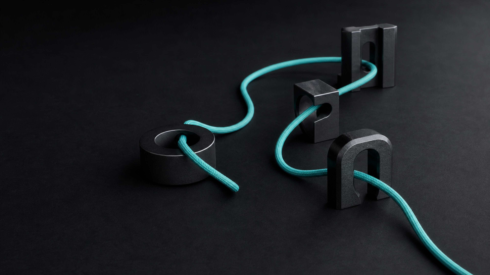

<p align="right"><a href="./README.en.md">English</a></p>

<p align="center">
  
</p>

<h1 align="center">loop</h1>

<p align="center"><strong>一次触发，三个深循环，交付可验证结果。</strong></p>

<p align="center">
  <a href="#安装"></a>
  <a href="https://github.com/nxxxsooo/loop/releases"></a>
  <a href="./LICENSE"></a>
</p>

`loop` 是持久的产品工作编排器：一次触发后，普通回复持续当前子循环，按产物就绪状态从想法推进到已验证结果。安装了 Superpowers 时，日常执行默认走 Superpowers，`loop` 隐式承接完整生命周期，不必显式点名；它的重定向模式负责跨工作流的解释与续接控制，不创建第二份持久计划。

在 OpenCode 中，loop 构建会把请求的终点注册为内置 `/goal`。OpenCode 的 reviewer 持续推进会话，直到可见证据表明终点已达成。重定向解释会暂停目标；停止或切换任务会清除目标。

```text
想法 -> deep-grill -> Product Brief
     -> deep-design -> Build Contract
     -> deep-build -> 已验证结果
```

## 安装

**完整工作流用本仓库；只需要想法澄清与方案审查，请到 [deep-grill 独立仓库](https://github.com/nxxxsooo/deep-grill)。** 两者使用同一份 DG 源码，独立仓可单独发布和更新。

一条命令安装完整的 5 个 Skill：Loop 自己维护的 4 个 Skill，以及按上游提交打包的 `impeccable`：

```bash
npx skills@latest add nxxxsooo/loop --skill '*'
```

需要直接完成全局安装时：

```bash
npx skills@latest add nxxxsooo/loop --skill '*' -g -y
```

只装部分 Skill 时按名称选择，例如 `--skill loop --skill deep-grill`。GSAP、React Bits 和 shadcn 指南随 `deep-design` 安装，不会作为独立 Skill 出现在安装列表。

只安装独立 DG：

```bash
npx skills@latest add nxxxsooo/deep-grill --skill deep-grill -g -y
```

直接描述想法或明确说 `$loop` 都可以启动这条产品生命周期：

> 使用 $loop 把这个想法推进到设计和实现。

后续普通回复会继续当前子循环。你也可以单独调用任意 `deep-*` Skill；直接调用只完成该项工作，不会自动开启完整生命周期。

## Bundle 内容

自己的 Skill（本仓库维护，`skills/`）：

| Skill | 负责内容 | 就绪条件 |
|---|---|---|
| `loop` | 产品生命周期、产物迁移与重定向解释 | 请求终点完成，或用户选择如何续接 |
| [`deep-grill`](https://github.com/nxxxsooo/deep-grill) | 想法澄清和对抗性审查；支持独立安装与更新 | Product Brief 或审查结论确认 |
| `deep-design` | 产品规格与实现设计 | Build Contract 确认 |
| `deep-build` | 实现、验证和授权范围内的交付 | 必过场景成功 |

打包的外部 Skill（`skills/vendor/`，原样保留上游内容）：

| Skill | 上游 | 作用 |
|---|---|---|
| `impeccable` | `pbakaus/impeccable` | 界面设计、重构、审查与打磨 |

[`deep-design` 参考索引](./skills/deep-design/SKILL.md#on-demand-component-and-motion-guidance)包含 `greensock/gsap-skills` 的 8 个官方主题，以及 React Bits 和 shadcn 指南。`impeccable`、GSAP 参考文件及许可证的上游提交和文件哈希记录在 [`bundle-sources.json`](./bundle-sources.json)，由 `scripts/check-bundle.py` 校验。

## `?` 与 `$what`：解释后再续接

在任一活跃工作流中，整条消息只有：

```text
?
```

或显式调用 `$what`（OpenCode 中为 `@what`），都会进入 loop 的重定向模式，暂停当前动作。它会说明最后确认点、当前工作流和步骤、已变化的产物、这些状态的重要性，以及原本准备执行的下一步。普通句子里包含 `?` 不会触发；没有可续接任务时，会询问要围绕哪个任务解释。

在 [OpenCode Annotate](https://github.com/nxxxsooo/opencode-annotate) 中选中一段文字并按 **what?** 即可标记。附加的重定向指令会进入 loop 的同一模式：先用平实语言逐段解释标记内容，必要时举例，再决定是否继续原来的下一步。

解释活跃工作后，loop 必须等待你选择「继续（推荐）」「调整下一步」或「停止」；只有选择继续，才会执行原本的下一步。客户端原生提问工具当前可调用时使用本地化原生界面；不可调用时立即在当前模式用同语言的简洁文字给出相同选择。不会为了提问或续接要求切换到 Plan mode。

## 原生问题工具

`deep-grill` 和 `deep-design` 用当前客户端的原生问题界面处理归用户所有的实质决定。`request_user_input` 当前可调用时直接使用；当前模式不可调用、客户端不支持，或你明确选择文字时，立即用同语言的简洁问题继续，不暂停等待模式切换。两者会保留待决分支和推荐项，并接受普通回复继续同一决策树。

## 规格与设计

`deep-design` 负责完整的规格和设计过程。Superpowers 在可用时提供日常 TDD、调试、评审和验证方法，但不应额外创建持久计划。相关 OpenSpec change 已经活跃时，它的 artifacts 是唯一的实体 Build Contract 和任务状态；仅初始化了 OpenSpec 不会触发新 change。只有用户明确要求，或工作属于耐久、多会话、跨组件、迁移、安全、重要架构或需要长期交接的范围，才创建或使用新的 OpenSpec change。

领域、架构、前端、测试和交付等专家能力由当前子循环按需调用，用户无需管理内部路由。

`deep-design` 统筹设计流程并产出 Build Contract；`impeccable` 负责界面设计、审查与打磨，其结果回到同一份契约。`design-taste-frontend` 已停用，不再作为默认专家、依赖或 bundle 内容。

### UI 设计与重构

`deep-design` 同时承接新 UI、局部重构和完整重构：确认范围与保留行为，选择产品／UI／两者／不做外部研究，提供有真实图片和逐项反馈的参考板，视觉选择可在环境允许时走本地浏览器实时评审，收敛视觉与交互方向，再决定是否先做高保真预览。已确认的选择直接复用，后端任务跳过这些 UI 步骤。

如已安装 `ui-research`，可按需用于参考研究。查找免费动效时阅读内置 React Bits 指南，使用 shadcn/ui 时阅读 shadcn 指南，Build Contract 选定 GSAP 时阅读相关主题。研究数量、付费页面和特定客户端模式都不是额外门槛。旧 `rebuild-ui-design` 的流程已融入；界面设计与改进由 `impeccable` 提供方法，生产实现由 `deep-build` 负责。

所有决定进入同一份 Build Contract。`deep-build` 负责实际页面、浏览器交互和截图验证；大范围重构先验收一个代表性完整流程，再迁移剩余页面。预览修订不会被当作批准，也不会因为研究了某个组件就自动安装它。

参考方法见 [UI 工作流](skills/deep-design/references/ui-design-workflow.md) 和 [视觉证据](skills/deep-design/references/visual-evidence.md)。

## 完整 loop 契约

以下内容与 [`skills/loop/SKILL.md`](./skills/loop/SKILL.md) 保持完全一致：

<!-- loop-skill-body:start -->
> # Loop
>
> ## Select The Mode
>
> Use **build mode** for end-to-end product work as defined below. Use **reorientation mode** for an entire trimmed `?` message, explicit `$what` or `@what` invocation, an explicit request for loop's reorientation mode, attached reorientation instructions, or a request to re-orient after not understanding the current update. An ordinary question merely containing `?` does not trigger it.
>
> Reorientation takes precedence over automatic progression, including inside an active child or a non-product workflow. Read [Reorientation and continuation](references/reorientation.md) before responding, especially for attached review feedback with `what?` annotations. Explain those passages first, pause the pending action, and wait for an explicit continuation choice. This mode neither starts a product build loop nor replaces the current workflow or its state.
>
> ## Build Mode
>
> Own progression, not the child methods. Route the active product task through three artifact contracts:
>
> ```text
> deep-grill -> confirmed Product Brief
> deep-design -> confirmed Build Contract
> deep-build -> verified result
> ```
>
> ## Keep The Loop Active
>
> A fresh build loop starts when the user invokes `loop` for product progression or wants a product idea, feature, app, or tool built end to end across more than one stage. Single-stage requests and small fixes stay with the matching child or ordinary work. After that, treat every ordinary reply as a continuation of the same loop until the goal is achieved, the user stops, the user clearly changes tasks, or further work requires authority outside the original request. A reorientation trigger pauses this progression until the user explicitly resumes it. The user does not need to name `loop` or any child again.
>
> Resume the current child while its output contract is incomplete. When its artifact is confirmed, select the next child from artifact readiness without asking the user to nominate a skill or choose a route. State the transition briefly and continue in the same response when the next action is already authorized. Artifact readiness chooses the child; it does not expand the user's authority or the requested endpoint.
>
> ## Route By Artifact Readiness
>
> - Use `deep-grill` when no confirmed Product Brief exists, when root product intent is unresolved, or when the requested endpoint is an isolated adversarial audit. Discovery mode produces the Product Brief; audit mode may finish without advancing when an audit is the whole request.
> - Use `deep-design` when the Product Brief is confirmed but no confirmed Build Contract exists.
> - Use `deep-build` when the Build Contract is confirmed and implementation is authorized.
> - Resume the same child when its contract is incomplete, even after a mode switch, clarification, or ordinary user answer.
> - Return an invalidated artifact to the child that produces it. A root product contradiction returns to `deep-grill`; a material behavior, interface, task, or verification gap returns to `deep-design`.
> - Honor a direct invocation of a child skill. Direct use does not require `loop`, but it also does not activate the persistent loop unless the user invokes `loop` or asks for end-to-end work as defined above.
>
> The active child selects any domain, architecture, research, interface, visual-design, testing, deployment, or other specialist it needs. The user does not manage internal routing.
>
> ## Preserve One Source Of State
>
> Carry the goal, current child, confirmed artifacts, constraints, authority, and evidence through the conversation and artifact references. For sustained work, use the active client's native goal or plan mechanism when available. Do not create duplicate workflow state, custom gates, hooks, or background processes.
>
> ## Set The Native Goal
>
> When a build loop starts, register its requested endpoint as the client's native goal without asking, and state the goal in one line. The goal holds the endpoint, never the child route or artifact state. In OpenCode, set it on the current session from the shell:
>
> ```sh
> opencode api post "/api/session/$OPENCODE_SESSION_ID/command" -d '{"name":"goal","text":"<objective>","delivery":"steer"}'
> ```
>
> Write the objective in the user's language, under 4000 characters: the endpoint, the project, authority limits (for example no deploy or publish), and observable done-when evidence. The same call with `text` set to `pause`, `resume`, or `clear` controls the goal; an empty `text` returns its status inside a `CommandExecutionError`, which is a status report rather than a session failure. OpenCode's reviewer judges completion from visible evidence after each turn and keeps the session going until then, so show verification output.
>
> - Check status first and skip setting a goal when one is already active for this endpoint. Single-stage work and reorientation mode set no goal.
> - Ask user decisions through the native question tool inside the turn. Ending a turn to wait for a prose answer lets the reviewer pause the goal as blocked; when the user's next ordinary reply continues the loop, resume it.
> - Pause the goal before a reorientation explanation and resume it only when the user chooses Continue.
> - Clear the goal when the user stops, changes tasks, or changes the endpoint; set a new one if the new endpoint still spans stages.
>
> Never imitate a child contract inside `loop`. Delegate the work, accept its artifact only when its readiness rules are met, and reroute from evidence. Stop when the requested endpoint is complete, the user stops or changes tasks, progress requires new authority, or remaining work has diminishing returns.
<!-- loop-skill-body:end -->

## Raycast

导入 [`skills/loop/assets/raycast-snippets.json`](./skills/loop/assets/raycast-snippets.json)，即可使用 `loop ;lp`、`deep grill ;dg`、`deep design ;dd`、`deep build ;db` 和 `loop reorient ;wt`。下面的 bundle 刷新命令会更新已安装的 Skill 和这个 JSON 文件，但不会修改已经导入 Raycast 的条目；请原位更新这五条，并替换原来的独立重定向条目，避免重复入口。

## 更新

已安装副本是快照。刷新整套 bundle 可更新 Skill、内置参考资料和随包分发的 `impeccable`：

```bash
# 发布后刷新整个 loop bundle
npx skills@latest add nxxxsooo/loop --skill '*' -g -y
```

`update loop` 只按现有 lock 记录更新 `loop`，不会刷新同 bundle 的其他 Skill。每次发布后请用上面的 bundle `add` 命令。它不会删除旧条目：确认替代参考资料已安装后，如果不再需要单独暴露，可以移除旧的 `gsap-*`、`react-bits` 和 `shadcn` 条目。重定向模式已归入 `loop`，也可以移除旧的独立 `what` 条目。

如果客户端已经缓存 Skill 元数据，请重新加载或新建任务。

## 维护与独立发布

DG 的唯一维护源码在 [`skills/deep-grill/`](./skills/deep-grill/)，包含独立仓 README、图片和校验脚本。独立仓是分发入口，不再反向作为 loop 的上游。导出和单独发布流程见 [维护说明](./docs/standalone-deep-grill.md)。DG 可以单独更新，无需同时发布整个 loop；已安装副本仍需按各自来源刷新，避免混用两个安装来源。

## 许可证

Loop 使用 [MIT License](./LICENSE)，`deep-grill` 附有自己的 MIT 许可证。GSAP 和 shadcn 参考资料保留上游 MIT 条款；`impeccable` 按 Apache-2.0 分发，并附上游 `NOTICE.md`。详见 [`THIRD_PARTY_NOTICES.md`](./THIRD_PARTY_NOTICES.md)。
