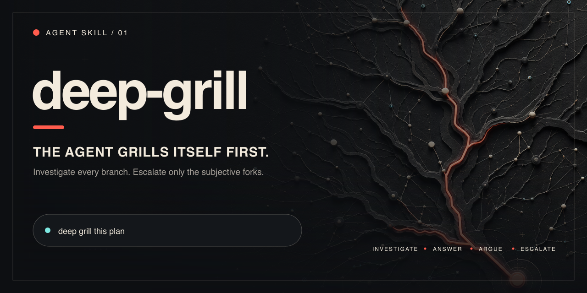

<p align="right">
  <a href="./README.zh-CN.md"></a>
</p>

<p align="center">
  
</p>

<h1 align="center">deep-grill</h1>

<p align="center"><strong>Clarify the idea. Challenge the answer.</strong></p>

<p align="center">
  One evidence-driven skill for discovering what should be built and auditing what is already formed.
</p>

<p align="center">
  <a href="#quickstart"></a>
  <a href="./LICENSE"></a>
</p>

**Need the complete idea → design → build workflow? Go to [loop](https://github.com/nxxxsooo/loop).** This repository provides independently installable and updatable DG only.

## One method, two modes

| Input | Mode | Output |
| --- | --- | --- |
| Raw idea, unclear intent, or user-owned decision tree | Discovery | Confirmed Product Brief |
| Formed plan, design, decision, or implied approach | Audit | Verdict and revisions |

Both modes use the same branch loop: investigate facts, expose the current decision frontier, challenge provisional answers, and continue until the output is confirmed. Both are self-contained within deep-grill; no other skill is required.

## Quickstart

Install globally:

```bash
npx skills@latest add nxxxsooo/deep-grill --skill deep-grill -g -y
```

Then say `deep grill this idea` or `deep grill this plan`. After the first invocation, ordinary replies continue the active session; you do not need to name the skill again.

In the broader [`loop`](https://github.com/nxxxsooo/loop) workflow, `deep-grill` owns idea clarification and adversarial review. A confirmed Product Brief advances automatically to `deep-design`.

## Native questions

When the active client exposes a native question interface and it is callable now, deep-grill uses it. When that interface is unavailable in the current mode, deep-grill immediately asks the same concise localized prose question, preserves the current frontier and recommendation, and continues from your ordinary reply. It also uses concise numbered prose when the client has no native question interface or you explicitly choose prose.

## Product Brief

Discovery mode finishes with a concise, confirmed contract covering the product or offer, target user and context, problem and desired outcome, constraints, non-goals, decisions, evidence and assumptions, success scenarios, and residual risks. It does not begin design or implementation.

## The entire skill

This is the full [`SKILL.md`](./SKILL.md) body you install:

<!-- deep-grill-skill-body:start -->
> # Deep Grill
>
> Run one evidence-driven branch loop in either **discovery mode** or **audit mode**. Facts belong to the agent; goals, priorities, risk tolerance, taste, and authority belong to the user.
>
> ## Select The Mode
>
> Use discovery mode when the input is a raw idea, the user asks to be interviewed or clarified, `loop` supplies work without a ready Product Brief, or materially different approaches depend on a user-owned decision tree. Its output is a confirmed Product Brief.
>
> Use audit mode when the user supplies a formed plan, design, decision, or implied approach and wants autonomous pressure-testing, a verdict, or revisions. Its output is an audit verdict.
>
> If the mode is initially unclear, state and audit the smallest plausible approach. Switch to discovery mode only when continuing would invent a material user-owned decision. Discovery mode may use audit passes between question rounds; both modes are self-contained within deep-grill.
>
> ## Keep The Session Active
>
> After deep-grill starts, treat each answer to its question round as a continuation of the same session. Reconstruct the current branch tree from the conversation and artifacts, apply the answer, and continue. The user does not need to invoke `deep-grill` or `loop` again.
>
> End the session when the user confirms the Product Brief or audit verdict, asks to stop, clearly changes tasks, or authorizes a separate next phase after deep-grill is complete.
>
> ## Work The Branches
>
> Map material branches in dependency order. The **frontier** is every branch whose prerequisites are settled.
>
> Investigate factual branches with the available environment, sources, tests, and bounded experiments. For each provisional answer, use the strongest objection and a concrete failure scenario to keep, revise, or reject it. Mark insufficient evidence and provide a validation path instead of inventing facts. An unresolved factual check blocks only dependent branches.
>
> Ask the user only about frontier decisions that the agent cannot own. Recompute the frontier after every answer or evidence change. Prioritize impact, uncertainty, and reversibility; stop at diminishing returns.
>
> ## Use Native Questions
>
> Before presenting the first user decision, determine from the active client's tool metadata whether its native question interface is callable now, unavailable in the current mode, or unsupported.
>
> - If callable, use one native question call for the round and include as many frontier decisions as the tool supports.
> - If unavailable in the current mode or unsupported, ask the same concise localized prose question immediately. Preserve the pending frontier and the recommended option, then continue from the ordinary reply.
> - If the user explicitly chooses prose, keep the same frontier and recommendation structure in concise numbered prose.
>
> Each native question and prose fallback asks one decision, offers two or three mutually exclusive options, puts and marks the recommended option first, explains its main tradeoff in one sentence, and preserves free-form input. Do not repeat a successful native question call in Markdown.
>
> ## Discovery Output
>
> When every material user-owned branch is settled, produce a concise Product Brief with the applicable fields:
>
> ```text
> Product / offer:
> Target user and context:
> Problem and desired outcome:
> Constraints and must-preserve behavior:
> Non-goals:
> Confirmed decisions:
> Evidence and assumptions:
> Success scenarios:
> Residual risks:
> ```
>
> Ask the user to confirm the brief through the native question interface when callable; otherwise use the same concise localized prose fallback under the same mode rules. The brief is ready for `deep-design` only after confirmation and when no root product decision remains open.
>
> ## Audit Output
>
> Report the target, verdict, recommended revisions, supporting evidence, strongest objections, failure scenarios, evidence limits, residual risks, unresolved items, and unexamined scope. Keep one or two bounded user choices inside the audit using the same native question and prose fallback rules. If a decision tree emerges, continue in discovery mode within deep-grill.
>
> Do not implement or otherwise act on a Product Brief or verdict until the user confirms it or separately authorizes the next phase.
<!-- deep-grill-skill-body:end -->

## Update

Installed copies are snapshots. Update a global installation with:

```bash
npx skills@latest add nxxxsooo/deep-grill --skill deep-grill -g -y
```

This refreshes DG only. If DG was installed from the loop bundle, either keep refreshing that bundle or explicitly switch to this standalone source; do not maintain competing copies of the same skill.

## Source and maintenance

The sole maintained source is [`loop/skills/deep-grill`](https://github.com/nxxxsooo/loop/tree/main/skills/deep-grill). This repository is exported from that directory and retains independent releases; DG updates do not require a loop release. Submit source changes to loop rather than editing both repositories. See the [maintenance guide](https://github.com/nxxxsooo/loop/blob/main/docs/standalone-deep-grill.md).

## License

[MIT](./LICENSE)
