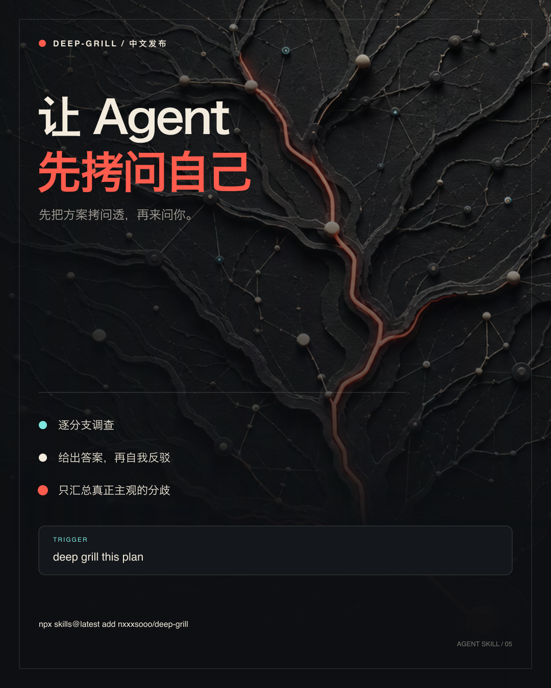

<p align="right">
  <a href="./README.md"></a>
</p>

<p align="center">
  
</p>

<h1 align="center">deep-grill</h1>

<p align="center"><strong>澄清想法，拷问答案。</strong></p>

<p align="center">
  一个由证据驱动的 Skill：既能把模糊想法变成产品简报，也能审查已经成形的方案。
</p>

**需要「想法 → 设计 → 实现」完整工作流？前往 [loop](https://github.com/nxxxsooo/loop)。** 本仓库只提供可独立安装、发布和更新的 DG。

## 一套方法，两种模式

| 输入 | 模式 | 输出 |
| --- | --- | --- |
| 原始想法、意图不清或归用户所有的决策树 | 探索模式 | 已确认的 Product Brief |
| 已成形的方案、设计、决定或隐含做法 | 审查模式 | 结论与修订建议 |

两种模式共用同一套分支循环：调查事实、暴露当前决策前沿、反驳暂定答案，并持续到产物获得确认。DG 自身包含完整方法，不依赖其他拷问 Skill。

## 快速开始

全局安装：

```bash
npx skills@latest add nxxxsooo/deep-grill --skill deep-grill -g -y
```

然后说 `deep grill this idea` 或 `deep grill this plan`。首次调用后，普通回复会继续当前会话，不必再次点名 Skill。

在完整的 [`loop`](https://github.com/nxxxsooo/loop) 工作流中，`deep-grill` 负责想法澄清和对抗性审查；Product Brief 确认后会自动进入 `deep-design`。

## 原生问题工具

如果当前客户端的原生问题界面可调用，deep-grill 就使用它。当前模式不可调用、客户端不支持，或你明确选择文字时，立即在当前模式用同语言的简洁文字提问，保留当前决策前沿和推荐项，并接受普通回复继续，不会要求切换模式后等待。

## Product Brief

探索模式最终形成一份精炼且经过确认的契约，包括产品或服务、目标用户与场景、问题与目标结果、约束、非目标、已确认决定、证据与假设、成功场景和剩余风险。它不会直接进入设计或实现。

## 完整 Skill

以下是安装的完整 [`SKILL.md`](./SKILL.md) 正文：

<!-- deep-grill-skill-body:start -->
> # Deep Grill
>
> Run one evidence-driven branch loop in either **discovery mode** or **audit mode**. Facts belong to the agent; goals, priorities, risk tolerance, taste, and authority belong to the user.
>
> ## Select The Mode
>
> Use discovery mode when the input is a raw idea, the user asks to be interviewed or clarified, `loop` supplies work without a ready Product Brief, or materially different approaches depend on a user-owned decision tree. Its output is a confirmed Product Brief.
>
> Use audit mode when the user supplies a formed plan, design, decision, or implied approach and wants autonomous pressure-testing, a verdict, or revisions. Its output is an audit verdict.
>
> If the mode is initially unclear, state and audit the smallest plausible approach. Switch to discovery mode only when continuing would invent a material user-owned decision. Discovery mode may use audit passes between question rounds; both modes are self-contained within deep-grill.
>
> ## Keep The Session Active
>
> After deep-grill starts, treat each answer to its question round as a continuation of the same session. Reconstruct the current branch tree from the conversation and artifacts, apply the answer, and continue. The user does not need to invoke `deep-grill` or `loop` again.
>
> End the session when the user confirms the Product Brief or audit verdict, asks to stop, clearly changes tasks, or authorizes a separate next phase after deep-grill is complete.
>
> ## Work The Branches
>
> Map material branches in dependency order. The **frontier** is every branch whose prerequisites are settled.
>
> Investigate factual branches with the available environment, sources, tests, and bounded experiments. For each provisional answer, use the strongest objection and a concrete failure scenario to keep, revise, or reject it. Mark insufficient evidence and provide a validation path instead of inventing facts. An unresolved factual check blocks only dependent branches.
>
> Ask the user only about frontier decisions that the agent cannot own. Recompute the frontier after every answer or evidence change. Prioritize impact, uncertainty, and reversibility; stop at diminishing returns.
>
> ## Use Native Questions
>
> Before presenting the first user decision, determine from the active client's tool metadata whether its native question interface is callable now, unavailable in the current mode, or unsupported.
>
> - If callable, use one native question call for the round and include as many frontier decisions as the tool supports.
> - If unavailable in the current mode or unsupported, ask the same concise localized prose question immediately. Preserve the pending frontier and the recommended option, then continue from the ordinary reply.
> - If the user explicitly chooses prose, keep the same frontier and recommendation structure in concise numbered prose.
>
> Each native question and prose fallback asks one decision, offers two or three mutually exclusive options, puts and marks the recommended option first, explains its main tradeoff in one sentence, and preserves free-form input. Do not repeat a successful native question call in Markdown.
>
> ## Discovery Output
>
> When every material user-owned branch is settled, produce a concise Product Brief with the applicable fields:
>
> ```text
> Product / offer:
> Target user and context:
> Problem and desired outcome:
> Constraints and must-preserve behavior:
> Non-goals:
> Confirmed decisions:
> Evidence and assumptions:
> Success scenarios:
> Residual risks:
> ```
>
> Ask the user to confirm the brief through the native question interface when callable; otherwise use the same concise localized prose fallback under the same mode rules. The brief is ready for `deep-design` only after confirmation and when no root product decision remains open.
>
> ## Audit Output
>
> Report the target, verdict, recommended revisions, supporting evidence, strongest objections, failure scenarios, evidence limits, residual risks, unresolved items, and unexamined scope. Keep one or two bounded user choices inside the audit using the same native question and prose fallback rules. If a decision tree emerges, continue in discovery mode within deep-grill.
>
> Do not implement or otherwise act on a Product Brief or verdict until the user confirms it or separately authorizes the next phase.
<!-- deep-grill-skill-body:end -->

## 更新

已安装副本是快照。更新全局安装：

```bash
npx skills@latest add nxxxsooo/deep-grill --skill deep-grill -g -y
```

这只刷新 DG。如果 DG 原本随 loop bundle 安装，请继续刷新 bundle，或明确切换到独立仓来源，不要同时维护同名 Skill 的两份安装。

## 源码与维护

唯一维护源码在 [`loop/skills/deep-grill`](https://github.com/nxxxsooo/loop/tree/main/skills/deep-grill)。本仓库由该目录导出，保留独立发布能力；DG 更新不必同时发布 loop。源码修改应提交到 loop，不再两边各改一份。流程见 [维护说明](https://github.com/nxxxsooo/loop/blob/main/docs/standalone-deep-grill.md)。

## 许可证

[MIT](./LICENSE)
